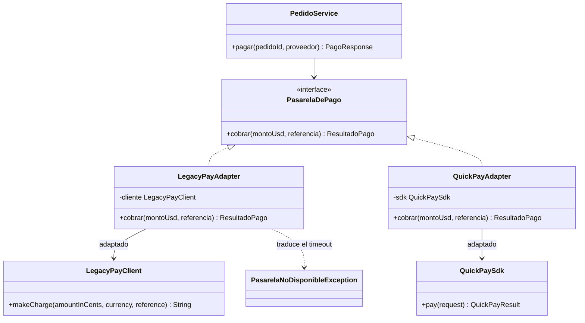
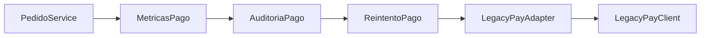
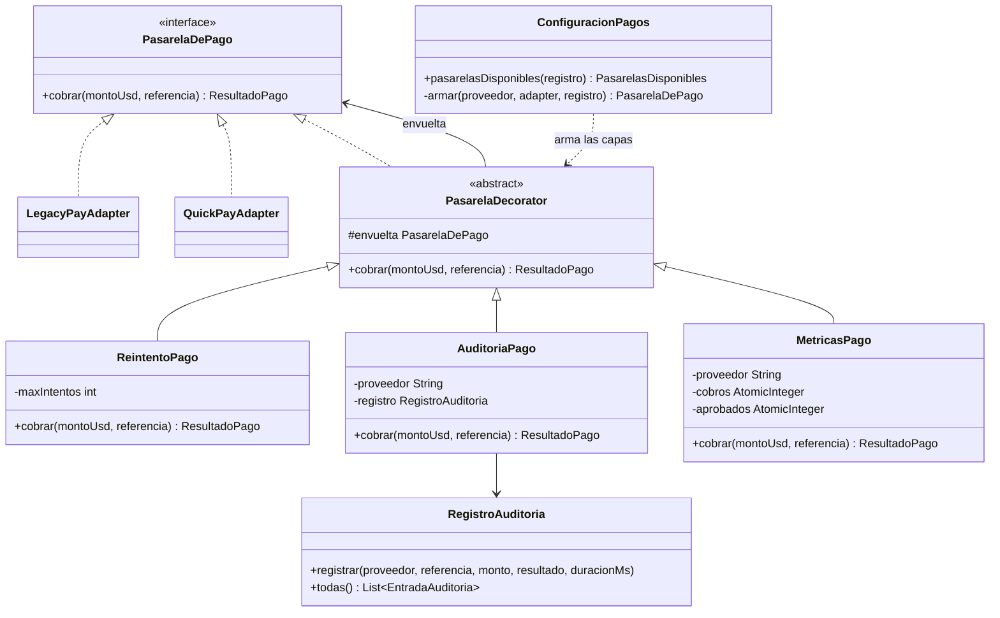

# ShopFlow 

## Sección 1. Integrantes, roles y cómo ejecutar el proyecto

### Integrantes y roles

| Integrante | Rol | Patrones a cargo | Reto de extensión |
|---|---|---|---|
| Valentina Tamayo Ruiz | A | Builder y Abstract Factory | Perú (Abstract Factory) |
| Ricardo Andrés Cobarrubia | B | Adapter y Decorator | Métricas (Decorator) |
| Daniel Andrés Medina Castrillon | C | Proxy y Factory Method | WhatsApp (Factory Method) |

### Cómo ejecutar el proyecto

**Requisitos:** Java 17 o superior y Maven (o un IDE con soporte para Maven, como Eclipse/STS o IntelliJ).

```bash
# 1. Clonar el repositorio y entrar a la carpeta del proyecto
cd shopflow

# 2. Ejecutar la API
mvn spring-boot:run
```

La API queda disponible en `http://localhost:8080`. La documentación interactiva (springdoc/OpenAPI) queda en `http://localhost:8080/swagger-ui.html`.

**Ejecutar las pruebas unitarias (JUnit 5):**

```bash
mvn test
```
---

## Sección 2. Tabla de análisis de patrones (Anexo D)

| Patrón | Problema en ShopFlow (síntoma) | Participantes GoF → clases | Principio SOLID | Cuándo no usarlo |
|---|---|---|---|---|
| **Factory Method** | **PENDIENTE (Daniel, Rol C)** | **PENDIENTE** | **PENDIENTE** | **PENDIENTE** |
| **Abstract Factory** | Cada país exige una **familia** de piezas que deben ir juntas: impuesto, validación del documento del cliente y comprobante electrónico. Sin el patrón habría un `if (pais.equals("CO"))` repetido en varias clases, sería fácil mezclar el IVA de un país con el comprobante de otro, y abrir Perú obligaría a editar cada `if`. | **AbstractFactory:** `FabricaFacturacion`. **ConcreteFactory:** `FabricaColombia`, `FabricaMexico`, `FabricaPeru` (reto). **AbstractProduct:** `CalculadoraImpuestos`, `ValidadorIdentificacion`, `GeneradorComprobante`. **ConcreteProduct:** `CalculadoraImpuestosColombia/Mexico/Peru`, `ValidadorIdentificacionColombia/Mexico/Peru`, `GeneradorComprobanteColombia/Mexico/Peru`. **Client:** `ServicioFacturacion`. | **OCP** (un país nuevo es una fábrica nueva) y **DIP** (`ServicioFacturacion` depende de interfaces, no de las clases de cada país). | Cuando no hay familias (hay un solo producto) o cuando la familia cambia con frecuencia: agregar un producto nuevo a la familia obliga a modificar la interfaz `FabricaFacturacion` y **todas** las fábricas concretas. |
| **Builder** | Un pedido tiene 4 datos obligatorios, al menos un ítem y 6 opciones (dirección, recoger en tienda, cupón, nota de regalo, envío express, canal de notificación) con reglas que dependen unas de otras. Un constructor con 11 parámetros es fácil de llamar con el orden equivocado (por ejemplo, dos `String` invertidos), y con setters el pedido existe "a medias" y puede quedar inválido. | **Product:** `Pedido` (inmutable, constructor privado, sin setters). **Builder:** `Pedido.Builder` (clase estática anidada, versión de Bloch). **Director (quien dirige la construcción):** `PedidoService.crear()`, que traduce el JSON recibido (`PedidoRequest`) a llamadas al builder. **Apoyo:** `ItemPedido` (record). | **SRP** (`Pedido` representa el pedido; `Pedido.Builder` se encarga de construirlo y validarlo). | Para objetos con dos o tres parámetros, todos obligatorios: el builder duplica código sin aportar nada y hay que mantenerlo cada vez que el producto cambia de atributos. |
| **Adapter** | ShopFlow cobra con LegacyPay y QuickPay, dos SDK que no se pueden modificar y que no se parecen ni entre sí ni al modelo de ShopFlow. LegacyPay recibe el monto en centavos y responde un texto como `"00\|LP4051"`; QuickPay recibe un `double` y responde un enum propio. Sin el patrón, los centavos, los códigos del proveedor y sus enums quedarían regados por `PedidoService`, y cambiar de proveedor obligaría a reescribirlo. | **Target:** `PasarelaDePago`. **Adapter:** `LegacyPayAdapter`, `QuickPayAdapter`. **Adaptee:** `LegacyPayClient`, `QuickPaySdk` (paquete `externos`, sin cambios). **Client:** `PedidoService`. | **SRP** (la traducción de cada proveedor vive en una sola clase), **OCP** (un proveedor nuevo es un adapter nuevo) y **DIP** (el dominio depende de `PasarelaDePago`, una abstracción propia, y no del SDK). | Cuando el equipo controla las dos interfaces: ahí es más simple alinearlas. Tampoco cuando la idea es simplificar un subsistema completo; para eso está Facade. |
| **Decorator** | LegacyPay falla con timeout el 30 % de las veces, así que conviene reintentar. Auditoría exige registrar cada cobro de los dos proveedores (proveedor, monto, resultado y duración), y en pruebas los reintentos se tienen que poder apagar. Con herencia harían falta seis subclases (`LegacyPayConReintento`, `LegacyPayConAuditoria`, `LegacyPayConReintentoYAuditoria` y lo mismo para QuickPay), y cada capa nueva duplicaría la cuenta. | **Component:** `PasarelaDePago`. **ConcreteComponent:** `LegacyPayAdapter`, `QuickPayAdapter`. **Decorator:** `PasarelaDecorator`. **ConcreteDecorator:** `ReintentoPago`, `AuditoriaPago` y `MetricasPago` (reto B). **Composición:** `ConfiguracionPagos`, que arma las capas. | **OCP** (una capa nueva es una clase nueva), **SRP** (cada decorador hace una sola cosa) y **LSP** (una pasarela decorada se usa donde se espera cualquier `PasarelaDePago`). | Cuando las combinaciones son pocas y fijas (dos subclases alcanzan), cuando el cliente depende del tipo concreto o cuando una capa necesita saber qué otras capas hay en la cadena. Con muchas capas, depurar cuesta más. |
| **Proxy** | **PENDIENTE (Daniel, Rol C)** | **PENDIENTE** | **PENDIENTE** | **PENDIENTE** |

---

## Sección 3. Patrones: problema, participantes y endpoint

### 3.1 Builder

**Problema que resuelve en ShopFlow:** Crear un `Pedido` válido con 4 datos obligatorios (cliente, país, documento y contacto), al menos un ítem y seis opciones. Algunas reglas dependen de varias opciones a la vez:

- La dirección de envío es obligatoria si el pedido **no** se recoge en tienda.
- Un pedido para recoger en tienda **no** puede ser express.
- La nota de regalo admite máximo 140 caracteres.
- El pedido debe tener al menos un ítem y el país debe ser soportado.

Todas estas reglas viven en un solo lugar: `Pedido.Builder.build()` (método privado `validar()`), que lanza `IllegalArgumentException`. Como el constructor de `Pedido` es privado y no tiene setters, **no existe un `Pedido` inválido ni a medias**. El precio de cada `ItemPedido` se toma del catálogo, no del cliente.

**Participantes GoF → clases:**

| Participante GoF | Clase |
|---|---|
| Product | `Pedido` |
| Builder | `Pedido.Builder` (obligatorios en el constructor, opciones como métodos fluidos, `build()` valida y crea) |
| Director | `PedidoService.crear(PedidoRequest)` |
| Cliente | `PedidoController` |

**Endpoint que lo evidencia:** `POST /api/pedidos` (201 Created) y `GET /api/pedidos/{id}`.

### 3.2 Abstract Factory

**Problema que resuelve en ShopFlow:** Cada país exige una **familia** de objetos que deben ir juntos:

| País | Impuesto | Documento del cliente | Comprobante |
|---|---|---|---|
| Colombia (`CO`) | IVA 19 % | Cédula o NIT (6 a 10 dígitos) | Factura electrónica (DIAN) |
| México (`MX`) | IVA 16 % | RFC | CFDI (SAT) |
| Perú (`PE`, reto A) | IGV 18 % | DNI (8 dígitos) o RUC (11 dígitos) | Factura electrónica (SUNAT) |

Si un pedido mexicano se validara con reglas colombianas, la factura quedaría mal. Con el patrón, `ServicioFacturacion` recibe `List<FabricaFacturacion>` (inyectada por Spring), arma un mapa por país y factura **sin conocer ninguna clase concreta** y sin un `if` ni un `switch` por país. Como el cliente obtiene calculadora, validador y generador de **una sola** fábrica, las tres piezas son siempre de la misma familia.

**Participantes GoF → clases:**

| Participante GoF | Clase |
|---|---|
| AbstractFactory | `FabricaFacturacion` (`pais()`, `crearCalculadora()`, `crearValidador()`, `crearGenerador()`) |
| ConcreteFactory | `FabricaColombia`, `FabricaMexico`, `FabricaPeru` (reto), todas `@Component` |
| AbstractProduct | `CalculadoraImpuestos`, `ValidadorIdentificacion`, `GeneradorComprobante` (+ el record `Comprobante`) |
| ConcreteProduct | Paquetes `facturacion.colombia`, `facturacion.mexico`, `facturacion.peru` |
| Client | `ServicioFacturacion` |

**Endpoint que lo evidencia:** el campo `comprobante` en la respuesta de `POST /api/pedidos`.


### 3.3 Adapter

**Problema que resuelve en ShopFlow:** El dominio solo debe conocer su propia interfaz, `PasarelaDePago.cobrar(BigDecimal montoUsd, String referencia)`, pero los dos proveedores de pago hablan otro idioma y su código no se puede tocar. Cada adapter se pone en medio y traduce en las dos direcciones:

| Qué se traduce | `LegacyPayAdapter` | `QuickPayAdapter` |
|---|---|---|
| Monto | `BigDecimal` en dólares → `long` en centavos (`movePointRight(2)` y `longValueExact()`, sin perder precisión) | `BigDecimal` → `double` |
| Respuesta | texto `"código\|autorización"`: `00` → aprobado; `51` → rechazado «Fondos insuficientes»; otro código → «Transacción no permitida» | enum `OK` → aprobado; `REJECTED` y `ERROR` → rechazado |
| Error | `LegacyPayTimeoutException` (del SDK) → `PasarelaNoDisponibleException` (de ShopFlow) | no aplica: QuickPay informa el error con el estado `ERROR` |

Los dos son **adaptadores de objeto**: guardan el SDK como atributo (composición) en vez de heredar de él. Además, cada uno tiene un constructor que crea su propio SDK (`new LegacyPayAdapter(probabilidadTimeout)` y `new QuickPayAdapter()`). Gracias a eso ni siquiera `ConfiguracionPagos` importa el paquete `externos`: en `src/main/java` los únicos imports de ese paquete están en los dos adapters.



**Participantes GoF → clases:**

| Participante GoF | Clase |
|---|---|
| Target | `PasarelaDePago` (código base) |
| Adapter | `LegacyPayAdapter`, `QuickPayAdapter` |
| Adaptee | `LegacyPayClient`, `QuickPaySdk` (paquete `externos`, no se modifica) |
| Client | `PedidoService.pagar()` |

**Endpoint que lo evidencia:** `POST /api/pedidos/{id}/pago` con `{"proveedor": "LEGACYPAY"}` o `{"proveedor": "QUICKPAY"}`.

| Caso | Respuesta |
|---|---|
| Pago aprobado | 200 con `"estado": "PAGADO"` |
| Más de 2.000 USD con LegacyPay | 409 «Fondos insuficientes» |
| Pedido ya pagado | 409 |
| Proveedor que no existe | 400 |
| LegacyPay caído (sin reintentos o tras agotarlos) | 503 «LegacyPay no está disponible», no un 500 con la excepción del SDK |

El mismo pedido de 3.451 USD (dos portátiles con IVA) se rechaza con LegacyPay y se aprueba con QuickPay sin cambiar una línea de `PedidoService`: solo cambia la pasarela que se le entrega.

### 3.4 Decorator

**Problema que resuelve en ShopFlow:** A cada pasarela hay que agregarle comportamiento (reintentar, auditar y, en el reto, medir) sin tocar los adapters y sin una subclase por cada combinación. Cada decorador implementa `PasarelaDePago` y a la vez guarda otra `PasarelaDePago`, a la que le delega el cobro. Así una capa puede envolver a otra sin límite, y `PedidoService` no distingue una pasarela simple de una envuelta tres veces.

- **`PasarelaDecorator`** (abstracta): implementa `PasarelaDePago`, guarda la pasarela `envuelta` y por defecto le delega el cobro.
- **`ReintentoPago`:** reintenta hasta `max-intentos` veces, pero solo ante `PasarelaNoDisponibleException`. Un rechazo como «Fondos insuficientes» es una respuesta válida del proveedor y reintentarlo daría lo mismo. Si se agotan los intentos, la excepción sale y la API responde 503.
- **`AuditoriaPago`:** mide la duración, delega y registra proveedor, referencia, monto, resultado y duración en `RegistroAuditoria` (`@Component`). También registra el caso `NO DISPONIBLE` antes de dejar pasar el error.
- **`MetricasPago`** (reto B): cuenta cobros y aprobados y escribe la tasa de aprobación en consola.
- **`ConfiguracionPagos`:** único lugar que conoce las clases concretas. Construye cada adapter y lo envuelve según `application.properties`:

| Propiedad | Efecto |
|---|---|
| `shopflow.pagos.reintentos=true` | envuelve el adapter en `ReintentoPago` (`shopflow.pagos.max-intentos=3`) |
| `shopflow.pagos.auditoria=true` | envuelve lo anterior en `AuditoriaPago` |
| `shopflow.pagos.metricas` (por defecto `true`) | envuelve todo en `MetricasPago` (reto B) |

Con todo activo, un cobro con LegacyPay recorre esta cadena:



El orden importa. La auditoría está por fuera del reintento, así que registra una sola entrada por cobro aunque por dentro haya habido varios intentos, y su duración incluye esos intentos. Cambiar las propiedades cambia las capas sin modificar ninguna clase.



**Participantes GoF → clases:**

| Participante GoF | Clase |
|---|---|
| Component | `PasarelaDePago` |
| ConcreteComponent | `LegacyPayAdapter`, `QuickPayAdapter` |
| Decorator | `PasarelaDecorator` |
| ConcreteDecorator | `ReintentoPago`, `AuditoriaPago`, `MetricasPago` (reto B) |
| Composición | `ConfiguracionPagos` (arma las capas) |
| Apoyo | `RegistroAuditoria` (guarda las entradas) y `PasarelasDisponibles` (entrega la pasarela armada de cada proveedor; responde 400 si el proveedor no existe) |

**Endpoint que lo evidencia:** `GET /api/pagos/auditoria`. Cada entrada tiene proveedor, referencia del pedido, monto, resultado (`APROBADO`, `RECHAZADO: …` o `NO DISPONIBLE`), duración en milisegundos y fecha, y hay exactamente una entrada por cobro. Las entradas de LegacyPay que duran 600 o 900 ms muestran que hubo timeouts y que `ReintentoPago` los resolvió por dentro.

### 3.5 Proxy 

**PENDIENTE:**

### 3.6 Factory Method 

**PENDIENTE:**

---

## Sección 4. Retos de extensión

### Reto A Perú (Abstract Factory) 

**Qué se hizo:** Se agregó `FabricaPeru` con IGV del 18 %, RUC de 11 dígitos (también se acepta DNI de 8) y comprobante de la SUNAT. Un pedido con `"pais": "PE"` se factura correctamente. Solo se crearon archivos nuevos en el paquete `facturacion.peru`:

- `FabricaPeru` (`@Component`)
- `CalculadoraImpuestosPeru`
- `ValidadorIdentificacionPeru`
- `GeneradorComprobantePeru`

**Por qué no hizo falta modificar nada:** `ServicioFacturacion` recibe `List<FabricaFacturacion>`: Spring inyecta automáticamente toda fábrica anotada con `@Component`, y el servicio la registra por el código que devuelve `pais()`. `Pedido.Builder` ya acepta `PE` como país. No se editó ninguna clase existente.

**Evidencia (`git diff --stat`).** Guardada en `evidencias/retoPeru.txt`. 

```text
 .../facturacion/peru/CalculadoraImpuestosPeru.java | 20 ++++++++++++++
 .../shopflow/facturacion/peru/FabricaPeru.java     | 32 ++++++++++++++++++++++
 .../facturacion/peru/GeneradorComprobantePeru.java | 18 ++++++++++++
 .../peru/ValidadorIdentificacionPeru.java          | 17 ++++++++++++
 .../edu/unbosque/shopflow/PedidoBuilderTest.java   | 32 ++++++++++++++++++++++
 .../unbosque/shopflow/ServicioFacturacionTest.java | 31 +++++++++++++++++++++
 6 files changed, 150 insertions(+)
```

### Reto B Métricas (Decorator)

**Qué se hizo:** Se agregó el decorador `MetricasPago`. Cuenta los cobros y los aprobados de su pasarela y, después de cada cobro, escribe en consola la tasa de aprobación. Cada proveedor tiene su propia instancia, así que cada uno lleva su cuenta por separado. Un cobro que termina en `PasarelaNoDisponibleException` también se cuenta, como no aprobado.

- `MetricasPago` (archivo nuevo, extiende `PasarelaDecorator`)

**Qué se modificó:** solo `ConfiguracionPagos`, el punto de composición, que es la única excepción que permite el reto. Se le agregó la propiedad `shopflow.pagos.metricas` (activa por defecto, así que no hizo falta tocar `application.properties`) y una capa más en el método `armar(...)`:

```java
if (metricas) {
    pasarela = new MetricasPago(pasarela, proveedor);
}
```

La capa va por fuera del reintento para contar un cobro por pago y no uno por intento; si no, los timeouts que el reintento resuelve bajarían la tasa sin que el cliente hubiera visto un rechazo. Los adapters, los otros decoradores y `PedidoService` no cambiaron.

**Salida en consola** (un pedido aprobado con LegacyPay; un pedido de dos portátiles rechazado con LegacyPay y luego aprobado con QuickPay):

```text
[Métricas] LEGACYPAY: 1 cobros, 1 aprobados, tasa de aprobación 100%
[Métricas] LEGACYPAY: 2 cobros, 1 aprobados, tasa de aprobación 50%
[Métricas] QUICKPAY: 1 cobros, 1 aprobados, tasa de aprobación 100%
```

**Evidencia (`git diff --stat`).** Guardada en `evidencias/retoMetricas.txt`.

```text
 .../shopflow/pagos/ConfiguracionPagos.java         | 16 ++++++-----
 .../edu/unbosque/shopflow/pagos/MetricasPago.java  | 32 ++++++++++++++++++++++
 2 files changed, 41 insertions(+), 7 deletions(-)
```

Solo aparecen `MetricasPago` (nuevo) y `ConfiguracionPagos`. Las 7 líneas borradas de `ConfiguracionPagos` son comentarios que se quitaron en ese mismo commit; la lógica existente no cambió.

### Reto C WhatsApp (Factory Method) 

**PENDIENTE:**

---

## Sección 5. Respuestas a las preguntas de reflexión

### 1. ¿Cómo habría quedado `PedidoService` sin Factory Method ni Abstract Factory? ¿Cuántos `if` tendría y qué clases habría que modificar para abrir Perú y agregar WhatsApp?

Sin el patrón de Abstract Factory, la facturación necesitaría un condicional por país para cada pieza de la familia. Serían al menos tres bloques: uno para elegir el porcentaje de impuesto y calcularlo, otro para validar el documento y otro para generar el comprobante, cada uno con una rama por país.
Con dos países ya son 3 condicionales de 2 ramas. Para abrir Perú habría que editar cada uno de esos 3 condicionales (agregar una rama `PE`) en la clase que factura, y en cualquier otra clase que repita el `if`. Además nada impediría mezclar, por ejemplo, el IVA de un país con el comprobante de otro. Con el patrón, abrir Perú fue agregar 4 clases nuevas y 0 modificaciones.

**Parte de Factory Method** **PENDIENTE**

### 2. ¿Por qué las notificaciones usan Factory Method y la facturación usa Abstract Factory? (producto vs. familia de productos)

La facturación necesita crear una familia de productos relacionados: calculadora de impuestos, validador de identificación y generador de comprobante. Estas tres piezas deben ser del mismo país; si se mezclan, la factura queda mal. Por eso se usa Abstract Factory: el cliente (`ServicioFacturacion`) recibe un objeto fábrica (composición) y todo lo que le pide a esa fábrica es coherente entre sí. La consistencia queda garantizada por el diseño y no por la disciplina del programador.

**Parte de Factory Method** **PENDIENTE** 

### 3. Invertir el orden de los decoradores (reintento por fuera de la auditoría) y pagar cinco pedidos con LegacyPay. ¿Qué cambia en `GET /api/pagos/auditoria`? ¿Qué orden conviene y por qué?

Para el experimento se cambió temporalmente el orden en `ConfiguracionPagos.armar(...)`, dejando el reintento por fuera de la auditoría, y se pagaron cinco pedidos con LegacyPay:

```java
if (auditoria)  { pasarela = new AuditoriaPago(pasarela, proveedor, registro); }
if (reintentos) { pasarela = new ReintentoPago(pasarela, maxIntentos); }
```

**Qué cambia en `GET /api/pagos/auditoria`:** ahora la auditoría queda adentro y ve cada intento por separado. Cada timeout deja su propia entrada `NO DISPONIBLE` (de unos 300 ms), seguida de la entrada `APROBADO` del intento que sí funcionó, con la misma referencia de pedido. En nuestra prueba salieron **[COMPLETAR: número] entradas** para cinco cobros. Con el orden original salen exactamente cinco, una por pedido, y la duración de cada una incluye los reintentos.

**Qué orden conviene:** la auditoría por fuera, que es el orden que dejamos. Auditoría pide registrar cada cobro, y para el negocio un cobro es un pedido pagado, no cada intento técnico. Con el orden invertido, quien revise el registro ve varias entradas para el mismo pedido y puede pensar que se cobró dos veces. Ver cada intento sí sirve para medir qué tan estable es LegacyPay, pero ese es un dato de operación, no de auditoría.

### 4. `CatalogoCacheProxy` y `AuditoriaPago` tienen casi la misma estructura. ¿Por qué uno es Proxy y el otro Decorator?

**PENDIENTE** 

### 5. Si otro sistema cambia un precio directamente en el catálogo remoto, ¿qué problema tiene la caché del proxy? Proponga una solución.

**PENDIENTE**

### 6. `QuickPayAdapter` convierte `BigDecimal` a `double`. ¿Qué riesgo trae y por qué conviene que esa decisión viva en el adapter y no en el dominio?

**El riesgo:** `double` guarda los números en binario y muchos decimales no tienen una representación exacta (en Java, `0.1 + 0.2` da `0.30000000000000004`). Con dinero eso puede producir montos como 145.65999999 en vez de 145.66, y los errores se acumulan si se suman o multiplican varios valores. Por eso el resto de ShopFlow calcula subtotales, descuentos e IVA con `BigDecimal`.

**Por qué en el adapter:** la conversión la exige el SDK de QuickPay, así que es un detalle del proveedor y no una regla del negocio. Al dejarla en `QuickPayAdapter`, el riesgo queda en un solo punto y justo en la frontera: todos los cálculos se hacen exactos y solo el valor final se convierte, una vez, al salir hacia QuickPay. Si el proveedor cambiara su SDK para aceptar decimales exactos, solo cambiaría esa clase (SRP y DIP). LegacyPay, en cambio, recibe centavos enteros, y su adapter hace la conversión con `BigDecimal.movePointRight(2).longValueExact()`, que no pierde precisión y falla si el monto no cabe en un `long`.

### 7. ¿En qué parte del proyecto no convenía aplicar un patrón? Justifique con el criterio «cuándo no usarlo» del Anexo A.

- **`PagoRequest` y `PagoResponse` no usan Builder.** `PagoRequest` tiene un solo campo y `PagoResponse` se arma en un único lugar con todos sus datos, así que son records. El Anexo A dice que un builder para objetos con dos o tres parámetros, todos obligatorios, duplica código sin aportar nada.
- **`ReintentoPago` no aporta nada sobre QuickPay.** QuickPay nunca lanza `PasarelaNoDisponibleException` (avisa sus errores con el estado `ERROR`), así que esa capa no hace nada en su cadena. Hoy se aplica a los dos proveedores para que la configuración sea igual para ambos. Es un caso del criterio del Decorator: no agregar capas que no aportan, porque cada una complica la depuración.
- **`PasarelasDisponibles` no es un patrón.** Para elegir la pasarela por proveedor basta un mapa con una validación, sin Factory Method ni Abstract Factory: hay un solo producto que no cambia de forma (`PasarelaDePago`). El Anexo A recomienda empezar con lo simple y pasar a Factory Method solo cuando el condicional que elige la clase empiece a repetirse o a crecer.

### 8. Para cada patrón, indique el principio SOLID que aplica y cite la clase o la línea de código que lo evidencia.

| Patrón | Principio SOLID | Evidencia en el código |
|---|---|---|
| **Builder** | **SRP**: `Pedido` solo representa el pedido y `Pedido.Builder` solo lo construye y valida. | Constructor privado `private Pedido(Builder builder)` y método `Pedido.Builder.validar()`, donde viven todas las reglas de construcción; `Pedido` no tiene setters ni lógica de armado. |
| **Abstract Factory** | **OCP**: un país nuevo es una fábrica nueva, sin tocar el servicio. **DIP**: el servicio depende de interfaces, no de las clases de cada país. | **OCP:** `FabricaPeru` (reto A) se agregó sin modificar nada; `ServicioFacturacion` la toma del constructor `ServicioFacturacion(List<FabricaFacturacion> fabricasDisponibles)`. **DIP:** `ServicioFacturacion.facturar()` solo usa `FabricaFacturacion`, `CalculadoraImpuestos`, `ValidadorIdentificacion` y `GeneradorComprobante`. |
| **Adapter** | **SRP**: la traducción de cada proveedor vive en una sola clase. **OCP**: un proveedor nuevo es un adapter nuevo. **DIP**: el dominio depende de `PasarelaDePago`, no del SDK. | **SRP:** toda la traducción de LegacyPay está en `LegacyPayAdapter.cobrar()` (centavos con `movePointRight(2)`, separación del texto en código y autorización y `catch (LegacyPayTimeoutException e)`). **DIP:** `PedidoService.pagar()` solo usa `PasarelaDePago` y `ResultadoPago`; ninguna clase fuera de los adapters importa `co.edu.unbosque.shopflow.externos`. **OCP:** un proveedor nuevo sería otra clase que implemente `PasarelaDePago` más una línea `pasarelas.put(...)` en `ConfiguracionPagos`. |
| **Decorator** | **OCP**: una capa nueva es una clase nueva. **SRP**: cada decorador hace una sola cosa. **LSP**: una pasarela decorada reemplaza a cualquier `PasarelaDePago`. | **OCP:** el reto B agregó `MetricasPago` sin modificar los adapters ni los otros decoradores (`evidencias/retoMetricas.txt`). **SRP:** `ReintentoPago.cobrar()` solo reintenta y `AuditoriaPago.cobrar()` solo mide y registra. **LSP:** `PedidoService.pagar()` cobra con la `PasarelaDePago` que le entrega `PasarelasDisponibles.obtener()` sin saber cuántas capas tiene, y `AuditoriaPagoTest` usa `new AuditoriaPago(new ReintentoPago(...), ...)` donde se espera cualquier pasarela. |
| **Proxy** | **PENDIENTE (Daniel)** | **PENDIENTE** |
| **Factory Method** | **PENDIENTE (Daniel)** | **PENDIENTE** |

---

## Sección 6. Conclusiones del grupo y dificultades encontradas

### Conclusiones del grupo

**PENDIENTE** 

### Dificultades encontradas

**PENDIENTE** 
