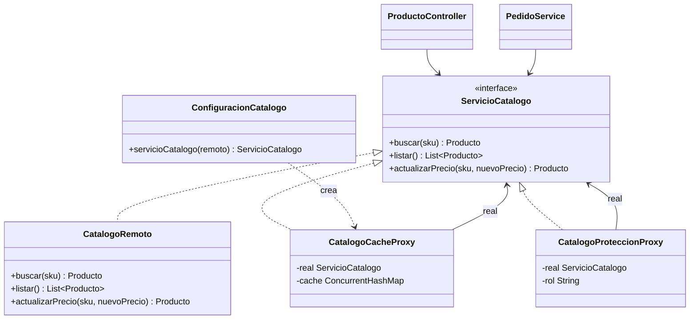
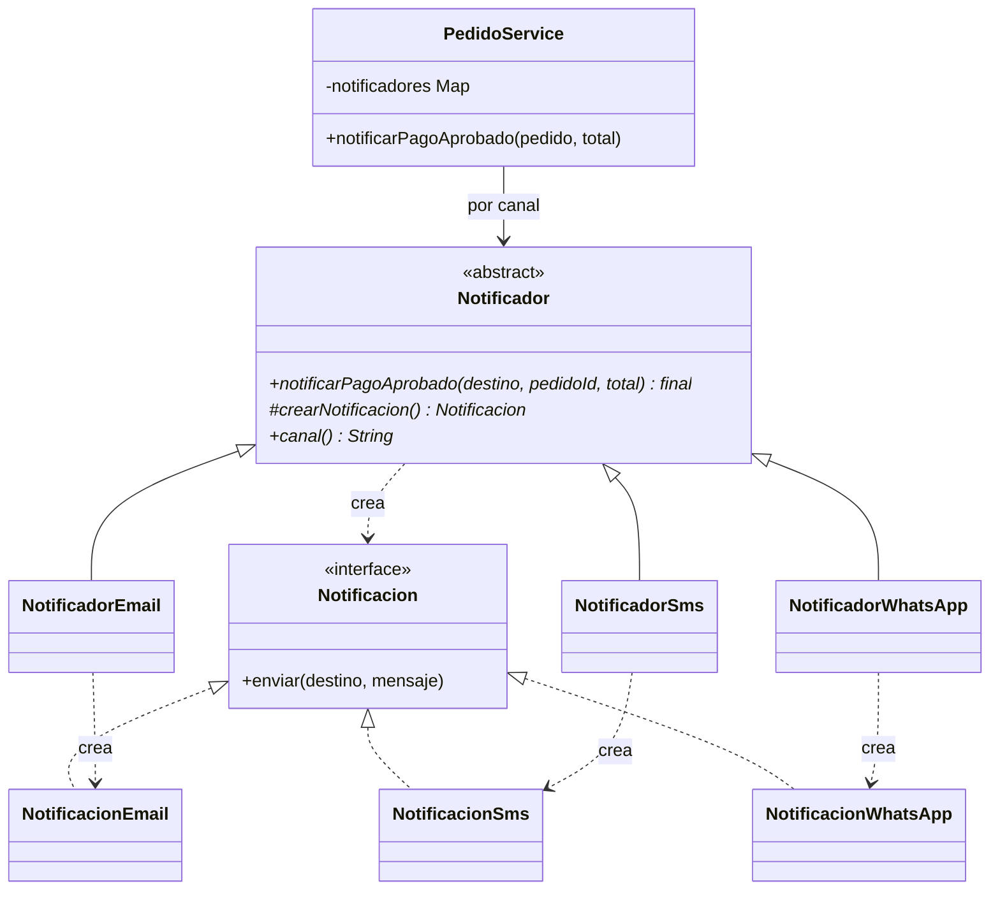

# ShopFlow 

## Sección 1. Integrantes, roles y cómo ejecutar el proyecto

### Integrantes y roles

| Integrante | Rol | Patrones a cargo | Reto de extensión |
|---|---|---|---|
| Valentina Tamayo Ruiz | A | Builder y Abstract Factory | Perú (Abstract Factory) |
| Ricardo Andrés Cobarrubia | B | Adapter y Decorator | Métricas (Decorator) |
| Daniel Andrés Medina Castrillon | C | Proxy y Factory Method | WhatsApp (Factory Method) |

### Cómo ejecutar el proyecto

**Requisitos:** Java 17 o superior y Maven (o un IDE con soporte para Maven, como Eclipse/STS o IntelliJ).

```bash
# 1. Clonar el repositorio y entrar a la carpeta del proyecto
cd shopflow

# 2. Ejecutar la API
mvn spring-boot:run
```

La API queda disponible en `http://localhost:8080`. La documentación interactiva (springdoc/OpenAPI) queda en `http://localhost:8080/swagger-ui.html`.

**Ejecutar las pruebas unitarias (JUnit 5):**

```bash
mvn test
```
---

## Sección 2. Tabla de análisis de patrones (Anexo D)

| Patrón | Problema en ShopFlow (síntoma) | Participantes GoF → clases | Principio SOLID | Cuándo no usarlo |
|---|---|---|---|---|
| **Factory Method** | Al aprobarse un pago hay que notificar al cliente por el canal que eligió (correo y SMS hoy; WhatsApp el próximo mes). El proceso es siempre el mismo —armar el mensaje, crear la notificación y enviarla—; lo que cambia es cómo se crea y se envía cada mensaje: un correo exige «@» y lleva asunto, y un SMS se recorta a 160 caracteres. Si `PedidoService` decidiera con un `if` qué clase instanciar (`new NotificacionEmail()` / `new NotificacionSms()`), cada canal nuevo obligaría a modificarlo. | **Product:** `Notificacion`. **ConcreteProduct:** `NotificacionEmail`, `NotificacionSms`, `NotificacionWhatsApp` (reto). **Creator:** `Notificador` (método plantilla `notificarPagoAprobado` y método fábrica `crearNotificacion()`). **ConcreteCreator:** `NotificadorEmail`, `NotificadorSms`, `NotificadorWhatsApp` (reto), todos `@Component`. **Client:** `PedidoService`. | **OCP** (un canal nuevo es un creador nuevo) y **DIP** (`PedidoService` depende de `Notificador`, no de las notificaciones concretas). | Cuando solo hay uno o dos canales que casi nunca cambian: un `if` es más claro y el patrón agrega dos jerarquías paralelas (creadores y productos). Tampoco cuando los productos no comparten un proceso común que valga la pena reutilizar en el método plantilla. |
| **Abstract Factory** | Cada país exige una **familia** de piezas que deben ir juntas: impuesto, validación del documento del cliente y comprobante electrónico. Sin el patrón habría un `if (pais.equals("CO"))` repetido en varias clases, sería fácil mezclar el IVA de un país con el comprobante de otro, y abrir Perú obligaría a editar cada `if`. | **AbstractFactory:** `FabricaFacturacion`. **ConcreteFactory:** `FabricaColombia`, `FabricaMexico`, `FabricaPeru` (reto). **AbstractProduct:** `CalculadoraImpuestos`, `ValidadorIdentificacion`, `GeneradorComprobante`. **ConcreteProduct:** `CalculadoraImpuestosColombia/Mexico/Peru`, `ValidadorIdentificacionColombia/Mexico/Peru`, `GeneradorComprobanteColombia/Mexico/Peru`. **Client:** `ServicioFacturacion`. | **OCP** (un país nuevo es una fábrica nueva) y **DIP** (`ServicioFacturacion` depende de interfaces, no de las clases de cada país). | Cuando no hay familias (hay un solo producto) o cuando la familia cambia con frecuencia: agregar un producto nuevo a la familia obliga a modificar la interfaz `FabricaFacturacion` y **todas** las fábricas concretas. |
| **Builder** | Un pedido tiene 4 datos obligatorios, al menos un ítem y 6 opciones (dirección, recoger en tienda, cupón, nota de regalo, envío express, canal de notificación) con reglas que dependen unas de otras. Un constructor con 11 parámetros es fácil de llamar con el orden equivocado (por ejemplo, dos `String` invertidos), y con setters el pedido existe "a medias" y puede quedar inválido. | **Product:** `Pedido` (inmutable, constructor privado, sin setters). **Builder:** `Pedido.Builder` (clase estática anidada, versión de Bloch). **Director (quien dirige la construcción):** `PedidoService.crear()`, que traduce el JSON recibido (`PedidoRequest`) a llamadas al builder. **Apoyo:** `ItemPedido` (record). | **SRP** (`Pedido` representa el pedido; `Pedido.Builder` se encarga de construirlo y validarlo). | Para objetos con dos o tres parámetros, todos obligatorios: el builder duplica código sin aportar nada y hay que mantenerlo cada vez que el producto cambia de atributos. |
| **Adapter** | **PENDIENTE (Ricardo, Rol B)** | **PENDIENTE** | **PENDIENTE** | **PENDIENTE** |
| **Decorator** | **PENDIENTE (Ricardo, Rol B)** | **PENDIENTE** | **PENDIENTE** | **PENDIENTE** |
| **Proxy** | El catálogo es de otro equipo y vive en otra máquina: `CatalogoRemoto` tarda 1,5 s por llamada (un pedido de tres productos tardaría 4,5 s solo en consultar precios) y no se puede modificar. Además, cambiar un precio es una operación restringida al rol ADMIN. Sin el patrón, la caché y el control de acceso se copiarían en cada lugar que consulta o cambia un precio. | **Subject:** `ServicioCatalogo`. **RealSubject:** `CatalogoRemoto`. **Proxy:** `CatalogoCacheProxy` (de caché) y `CatalogoProteccionProxy` (de protección). **Clients:** `ProductoController` y `PedidoService`, que reciben un `ServicioCatalogo` sin saber que es un proxy. **Composición:** `ConfiguracionCatalogo`. | **SRP** (la caché y los permisos salen del objeto real), **OCP** (se agrega control sin modificar `CatalogoRemoto`) y **LSP** (el proxy sustituye al sujeto real sin que el cliente lo note). | Cuando el objeto es barato y local (la indirección no aporta), cuando se necesitan datos siempre frescos y no se puede invalidar la caché con certeza (si otro sistema cambia un precio directamente en el catálogo remoto, la caché sirve el valor viejo), o cuando ocultar la red haría creer que la llamada es barata. |

---

## Sección 3. Patrones: problema, participantes y endpoint

### 3.1 Builder

**Problema que resuelve en ShopFlow:** Crear un `Pedido` válido con 4 datos obligatorios (cliente, país, documento y contacto), al menos un ítem y seis opciones. Algunas reglas dependen de varias opciones a la vez:

- La dirección de envío es obligatoria si el pedido **no** se recoge en tienda.
- Un pedido para recoger en tienda **no** puede ser express.
- La nota de regalo admite máximo 140 caracteres.
- El pedido debe tener al menos un ítem y el país debe ser soportado.

Todas estas reglas viven en un solo lugar: `Pedido.Builder.build()` (método privado `validar()`), que lanza `IllegalArgumentException`. Como el constructor de `Pedido` es privado y no tiene setters, **no existe un `Pedido` inválido ni a medias**. El precio de cada `ItemPedido` se toma del catálogo, no del cliente.

**Participantes GoF → clases:**

| Participante GoF | Clase |
|---|---|
| Product | `Pedido` |
| Builder | `Pedido.Builder` (obligatorios en el constructor, opciones como métodos fluidos, `build()` valida y crea) |
| Director | `PedidoService.crear(PedidoRequest)` |
| Cliente | `PedidoController` |

**Endpoint que lo evidencia:** `POST /api/pedidos` (201 Created) y `GET /api/pedidos/{id}`.

### 3.2 Abstract Factory

**Problema que resuelve en ShopFlow:** Cada país exige una **familia** de objetos que deben ir juntos:

| País | Impuesto | Documento del cliente | Comprobante |
|---|---|---|---|
| Colombia (`CO`) | IVA 19 % | Cédula o NIT (6 a 10 dígitos) | Factura electrónica (DIAN) |
| México (`MX`) | IVA 16 % | RFC | CFDI (SAT) |
| Perú (`PE`, reto A) | IGV 18 % | DNI (8 dígitos) o RUC (11 dígitos) | Factura electrónica (SUNAT) |

Si un pedido mexicano se validara con reglas colombianas, la factura quedaría mal. Con el patrón, `ServicioFacturacion` recibe `List<FabricaFacturacion>` (inyectada por Spring), arma un mapa por país y factura **sin conocer ninguna clase concreta** y sin un `if` ni un `switch` por país. Como el cliente obtiene calculadora, validador y generador de **una sola** fábrica, las tres piezas son siempre de la misma familia.

**Participantes GoF → clases:**

| Participante GoF | Clase |
|---|---|
| AbstractFactory | `FabricaFacturacion` (`pais()`, `crearCalculadora()`, `crearValidador()`, `crearGenerador()`) |
| ConcreteFactory | `FabricaColombia`, `FabricaMexico`, `FabricaPeru` (reto), todas `@Component` |
| AbstractProduct | `CalculadoraImpuestos`, `ValidadorIdentificacion`, `GeneradorComprobante` (+ el record `Comprobante`) |
| ConcreteProduct | Paquetes `facturacion.colombia`, `facturacion.mexico`, `facturacion.peru` |
| Client | `ServicioFacturacion` |

**Endpoint que lo evidencia:** el campo `comprobante` en la respuesta de `POST /api/pedidos`.


### 3.3 Adapter

**PENDIENTE:**

### 3.4 Decorator

**PENDIENTE:** 

### 3.5 Proxy

**Problema que resuelve en ShopFlow:** El catálogo es de otro equipo y vive en otra máquina: `CatalogoRemoto` simula esa latencia con 1,5 segundos por llamada y no se puede modificar. Los mismos productos se consultan miles de veces al día, y un pedido de tres productos tardaría 4,5 s solo en consultar precios. Además, cambiar un precio es una operación restringida al rol ADMIN. Ningún cliente del catálogo debería enterarse de si habla con el objeto real o con un intermediario, así que ambas responsabilidades se resuelven con dos proxies que implementan `ServicioCatalogo`:

- **`CatalogoCacheProxy` (proxy de caché):** guarda los productos en un `ConcurrentHashMap` y solo llama al catálogo remoto si el SKU no está en caché. Al cambiar un precio por su medio, actualiza la caché para no servir un precio viejo. Un SKU inexistente no se guarda (se vuelve a preguntar al remoto y responde 404).
- **`CatalogoProteccionProxy` (proxy de protección):** recibe el rol del usuario y lanza `AccesoDenegadoException` (403) si alguien distinto de ADMIN intenta cambiar un precio. Consultar es libre para cualquier rol. Se crea por petición porque el rol llega en el encabezado `X-Rol` y cambia de una petición a otra.
- **`ConfiguracionCatalogo`:** es el único lugar que sabe que existe el proxy de caché. Su `@Bean` (marcado `@Primary`, porque `CatalogoRemoto` también es un bean y no se puede modificar) entrega `new CatalogoCacheProxy(remoto)` como el `ServicioCatalogo` de toda la aplicación.

Los dos proxies se encadenan: `ProductoController` → `CatalogoProteccionProxy` → `CatalogoCacheProxy` → `CatalogoRemoto` (protección por fuera, caché por dentro). `PedidoService` también recibe el `ServicioCatalogo` con caché, así que los pedidos repetidos dejan de pagar la latencia.



**Participantes GoF → clases:**

| Participante GoF | Clase |
|---|---|
| Subject | `ServicioCatalogo` |
| RealSubject | `CatalogoRemoto` (código base, no se modifica) |
| Proxy | `CatalogoCacheProxy` (caché) y `CatalogoProteccionProxy` (protección) |
| Clients | `ProductoController` y `PedidoService` |
| Composición | `ConfiguracionCatalogo` (único lugar que conoce el proxy de caché) |

**Endpoint que lo evidencia:** `GET /api/productos`, `GET /api/productos/{sku}` (la segunda consulta del mismo SKU tarda menos de 50 ms) y `PUT /api/productos/{sku}/precio` (con `X-Rol: CLIENTE` responde 403; con `X-Rol: ADMIN` responde 200 y la siguiente consulta muestra el precio nuevo). Evidencias en `evidencias/escenario1.txt` y `evidencias/escenario2.txt`.

### 3.6 Factory Method

**Problema que resuelve en ShopFlow:** Cuando se aprueba un pago, ShopFlow notifica al cliente por el canal que eligió en el pedido (correo o SMS hoy; WhatsApp el próximo mes). El proceso es siempre el mismo: armar el mensaje, crear la notificación del canal y enviarla. Lo que cambia es la notificación: un correo exige un contacto con «@» y lleva asunto; un SMS se recorta a 160 caracteres. Si `PedidoService` decidiera con un `if` qué clase instanciar, cada canal nuevo obligaría a modificarlo.

Con el patrón, el proceso vive una sola vez en `Notificador.notificarPagoAprobado(...)` (método `final`), que llama al **método fábrica** `protected abstract Notificacion crearNotificacion()`. Cada creador concreto lo sobrescribe y devuelve su propio producto. `PedidoService` recibe `List<Notificador>` (inyectada por Spring), la indexa por `canal()` y, tras un pago aprobado, llama `notificarPagoAprobado(pedido, total)`, que busca el notificador del canal del pedido: no tiene ningún `new Notificacion...` ni un `if` por canal. Si el pedido trae un canal que no tiene notificador, `crear` responde 400.



**Participantes GoF → clases:**

| Participante GoF | Clase |
|---|---|
| Product | `Notificacion` (`enviar(destino, mensaje)`) |
| ConcreteProduct | `NotificacionEmail`, `NotificacionSms`, `NotificacionWhatsApp` (reto C) |
| Creator | `Notificador` (método plantilla `notificarPagoAprobado` y método fábrica `crearNotificacion()`, más `canal()`) |
| ConcreteCreator | `NotificadorEmail`, `NotificadorSms`, `NotificadorWhatsApp` (reto C), todos `@Component` |
| Client | `PedidoService` (`notificarPagoAprobado`) |
| Apoyo | `BandejaNotificaciones` (código base): simula el envío guardando cada notificación |

**Endpoint que lo evidencia:** `GET /api/notificaciones`: tras un pago aprobado aparece la notificación con el canal del pedido y el total pagado. Un pedido con un canal no soportado responde 400 en `POST /api/pedidos`.

---

## Sección 4. Retos de extensión

### Reto A Perú (Abstract Factory) 

**Qué se hizo:** Se agregó `FabricaPeru` con IGV del 18 %, RUC de 11 dígitos (también se acepta DNI de 8) y comprobante de la SUNAT. Un pedido con `"pais": "PE"` se factura correctamente. Solo se crearon archivos nuevos en el paquete `facturacion.peru`:

- `FabricaPeru` (`@Component`)
- `CalculadoraImpuestosPeru`
- `ValidadorIdentificacionPeru`
- `GeneradorComprobantePeru`

**Por qué no hizo falta modificar nada:** `ServicioFacturacion` recibe `List<FabricaFacturacion>`: Spring inyecta automáticamente toda fábrica anotada con `@Component`, y el servicio la registra por el código que devuelve `pais()`. `Pedido.Builder` ya acepta `PE` como país. No se editó ninguna clase existente.

**Evidencia (`git diff --stat`).** Guardada en `evidencias/retoPeru.txt`. 

```text
 .../facturacion/peru/CalculadoraImpuestosPeru.java | 20 ++++++++++++++
 .../shopflow/facturacion/peru/FabricaPeru.java     | 32 ++++++++++++++++++++++
 .../facturacion/peru/GeneradorComprobantePeru.java | 18 ++++++++++++
 .../peru/ValidadorIdentificacionPeru.java          | 17 ++++++++++++
 .../edu/unbosque/shopflow/PedidoBuilderTest.java   | 32 ++++++++++++++++++++++
 .../unbosque/shopflow/ServicioFacturacionTest.java | 31 +++++++++++++++++++++
 6 files changed, 150 insertions(+)
```

### Reto B Métricas (Decorator) 

**PENDIENTE:** 

### Reto C WhatsApp (Factory Method)

**Qué se hizo:** Se agregó el canal WhatsApp: exige un número con indicativo (por ejemplo, `+573001234567`) y antepone «✅» al mensaje. Un pedido con `"canalNotificacion": "WHATSAPP"` se notifica por ese canal. Solo se crearon archivos nuevos en el paquete `notificaciones`:

- `NotificacionWhatsApp` (producto concreto)
- `NotificadorWhatsApp` (creador concreto, `@Component`)
- `NotificadorWhatsAppTest` (prueba unitaria JUnit 5)

**Por qué no hizo falta modificar nada:** `PedidoService` recibe `List<Notificador>`: Spring inyecta automáticamente todo `@Component` que extienda `Notificador`, y el servicio lo registra por el código que devuelve `canal()`. `Pedido.Builder` acepta cualquier canal no vacío y `PedidoService` valida contra los notificadores registrados, así que `"WHATSAPP"` pasa a ser un canal soportado sin tocar ninguna clase existente.

**Evidencia (`git diff --stat`).** Guardada en `evidencias/retoWhatsApp.txt`.

```text
 .../notificaciones/NotificacionWhatsApp.java       | 30 +++++++++++
 .../notificaciones/NotificadorWhatsApp.java        | 23 +++++++++
 .../unbosque/shopflow/NotificadorWhatsAppTest.java | 60 ++++++++++++++++++++++
 3 files changed, 113 insertions(+)
```

---

## Sección 5. Respuestas a las preguntas de reflexión

### 1. ¿Cómo habría quedado `PedidoService` sin Factory Method ni Abstract Factory? ¿Cuántos `if` tendría y qué clases habría que modificar para abrir Perú y agregar WhatsApp?

Sin el patrón de Abstract Factory, la facturación necesitaría un condicional por país para cada pieza de la familia. Serían al menos tres bloques: uno para elegir el porcentaje de impuesto y calcularlo, otro para validar el documento y otro para generar el comprobante, cada uno con una rama por país.
Con dos países ya son 3 condicionales de 2 ramas. Para abrir Perú habría que editar cada uno de esos 3 condicionales (agregar una rama `PE`) en la clase que factura, y en cualquier otra clase que repita el `if`. Además nada impediría mezclar, por ejemplo, el IVA de un país con el comprobante de otro. Con el patrón, abrir Perú fue agregar 4 clases nuevas y 0 modificaciones.

**Parte de Factory Method:** Sin el patrón, `PedidoService` tendría que decidir con un `if` (o un `switch`) qué notificación instanciar:

```java
Notificacion n;
if (canal.equals("EMAIL"))      n = new NotificacionEmail(bandeja);
else if (canal.equals("SMS"))   n = new NotificacionSms(bandeja);
else throw new IllegalArgumentException("Canal no soportado");
```

Hoy serían 2 ramas más el caso de error, y habría que repetir ese `if` en cada lugar que cree o valide una notificación. Para agregar WhatsApp habría que **modificar `PedidoService`** (una rama nueva), con el riesgo de romper los otros canales. Con el patrón, WhatsApp fueron 2 clases de producción nuevas (`NotificacionWhatsApp` y `NotificadorWhatsApp`) y 0 modificaciones: `PedidoService` solo conoce `Notificador`.

### 2. ¿Por qué las notificaciones usan Factory Method y la facturación usa Abstract Factory? (producto vs. familia de productos)

La facturación necesita crear una familia de productos relacionados: calculadora de impuestos, validador de identificación y generador de comprobante. Estas tres piezas deben ser del mismo país; si se mezclan, la factura queda mal. Por eso se usa Abstract Factory: el cliente (`ServicioFacturacion`) recibe un objeto fábrica (composición) y todo lo que le pide a esa fábrica es coherente entre sí. La consistencia queda garantizada por el diseño y no por la disciplina del programador.

**Parte de Factory Method:** Las notificaciones solo necesitan crear **un producto**: la `Notificacion` del canal elegido. Qué clase concreta se crea lo decide una subclase del creador (`NotificadorEmail` crea `NotificacionEmail`, `NotificadorSms` crea `NotificacionSms`) mediante herencia, sobrescribiendo `crearNotificacion()`. No hay piezas que tengan que ser coherentes entre sí: el canal necesita un solo objeto. En cambio, la facturación necesita **una familia de productos** (calculadora, validador y generador) que deben ser del mismo país, y por eso el cliente recibe una fábrica completa por composición. Si algún día cada canal necesitara varias piezas coordinadas (por ejemplo plantilla, remitente y registro de entrega), ahí sí convendría pasar de Factory Method a Abstract Factory.

### 3. Invertir el orden de los decoradores (reintento por fuera de la auditoría) y pagar cinco pedidos con LegacyPay. ¿Qué cambia en `GET /api/pagos/auditoria`? ¿Qué orden conviene y por qué?

**PENDIENTE** 

### 4. `CatalogoCacheProxy` y `AuditoriaPago` tienen casi la misma estructura. ¿Por qué uno es Proxy y el otro Decorator?

Tienen la misma estructura (implementan la misma interfaz, guardan una referencia al objeto real y le delegan), pero **la intención** es distinta. `CatalogoCacheProxy` **controla el acceso** al catálogo remoto: decide si hace falta llegar al objeto real y cuándo, y puede evitar la llamada por completo si el producto ya está en caché. El objeto real (`CatalogoRemoto`) es el que presta el servicio; el proxy solo regula cómo se llega a él. `AuditoriaPago`, en cambio, **agrega una responsabilidad** que el cliente quiere (registrar proveedor, monto, resultado y duración de cada cobro) y siempre delega en la pasarela envuelta: no decide si el cobro se hace, solo lo enriquece. Regla práctica: si el envoltorio agrega funcionalidad, es Decorator; si controla si, cuándo o cómo se llega al objeto real (y a veces lo crea), es Proxy.

### 5. Si otro sistema cambia un precio directamente en el catálogo remoto, ¿qué problema tiene la caché del proxy? Proponga una solución.

La caché solo se entera de los cambios que pasan **por el proxy**. Si otro sistema cambia el precio directamente en el catálogo remoto, `CatalogoCacheProxy` sigue sirviendo el valor viejo indefinidamente (no tiene vencimiento): `GET /api/productos/{sku}` mostraría un precio desactualizado y, peor, los pedidos nuevos se crearían y se facturarían con ese precio viejo. Es exactamente el caso del criterio «cuándo no usarlo»: no se puede invalidar la caché con certeza.

Soluciones, de menor a mayor esfuerzo:

1. **Vencimiento (TTL):** guardar junto a cada producto la hora en que se cargó y volver a consultar al remoto cuando pasen N segundos (o usar una librería como Caffeine con `expireAfterWrite`). Es simple y acota el desfase al TTL elegido.
2. **Invalidación por evento:** que el equipo del catálogo publique un aviso (webhook o mensaje) cuando cambie un precio, y que el proxy llame a un método `invalidar(sku)`. El dato queda fresco casi de inmediato y se conserva la velocidad de la caché.
3. **Revalidar en la operación crítica:** aunque la caché se use para consultar, `PedidoService.crear` podría confirmar el precio con el remoto antes de facturar (a costa de la latencia que la caché quería evitar).

La recomendación es combinar 1 y 2: invalidación por evento como camino normal y TTL como red de seguridad si un aviso se pierde.

### 6. `QuickPayAdapter` convierte `BigDecimal` a `double`. ¿Qué riesgo trae y por qué conviene que esa decisión viva en el adapter y no en el dominio?

**PENDIENTE**

### 7. ¿En qué parte del proyecto no convenía aplicar un patrón? Justifique con el criterio «cuándo no usarlo» del Anexo A.

**PENDIENTE** 

### 8. Para cada patrón, indique el principio SOLID que aplica y cite la clase o la línea de código que lo evidencia.

| Patrón | Principio SOLID | Evidencia en el código |
|---|---|---|
| **Builder** | **SRP**: `Pedido` solo representa el pedido y `Pedido.Builder` solo lo construye y valida. | Constructor privado `private Pedido(Builder builder)` y método `Pedido.Builder.validar()`, donde viven todas las reglas de construcción; `Pedido` no tiene setters ni lógica de armado. |
| **Abstract Factory** | **OCP**: un país nuevo es una fábrica nueva, sin tocar el servicio. **DIP**: el servicio depende de interfaces, no de las clases de cada país. | **OCP:** `FabricaPeru` (reto A) se agregó sin modificar nada; `ServicioFacturacion` la toma del constructor `ServicioFacturacion(List<FabricaFacturacion> fabricasDisponibles)`. **DIP:** `ServicioFacturacion.facturar()` solo usa `FabricaFacturacion`, `CalculadoraImpuestos`, `ValidadorIdentificacion` y `GeneradorComprobante`. |
| **Adapter** | **PENDIENTE (Ricardo)** | **PENDIENTE** |
| **Decorator** | **PENDIENTE (Ricardo)** | **PENDIENTE** |
| **Proxy** | **LSP**: el proxy sustituye al sujeto real sin que el cliente lo note. **SRP**: la caché y los permisos salen del objeto real. **OCP**: se agrega control sin modificar `CatalogoRemoto`. | **LSP:** `CatalogoCacheProxy implements ServicioCatalogo` y `CatalogoProteccionProxy implements ServicioCatalogo`; `PedidoService` y `ProductoController` reciben un `ServicioCatalogo` (constructor `PedidoService(ServicioCatalogo catalogo, ...)`) sin saber que es un proxy. **SRP:** `CatalogoCacheProxy` solo cachea y `CatalogoProteccionProxy.actualizarPrecio()` solo valida el rol. **OCP:** `ConfiguracionCatalogo.servicioCatalogo(...)` es el único lugar que cambia para activar el proxy; `CatalogoRemoto` no se tocó. |
| **Factory Method** | **OCP**: un canal nuevo es un creador nuevo, sin tocar el servicio. **DIP**: `PedidoService` depende de la abstracción `Notificador`, no de las notificaciones concretas. | **OCP:** `NotificadorWhatsApp` (reto C) se agregó sin modificar nada; `PedidoService` lo recibe en el constructor `PedidoService(..., List<Notificador> notificadoresDisponibles)` y lo busca por `canal()`. **DIP:** `PedidoService.notificarPagoAprobado()` solo usa `Notificador`; el proceso común está en `Notificador.notificarPagoAprobado()` (método `final`) y cada subclase solo sobrescribe `crearNotificacion()`. |

---

## Sección 6. Conclusiones del grupo y dificultades encontradas

### Conclusiones del grupo

**PENDIENTE** 

### Dificultades encontradas

**PENDIENTE** 
